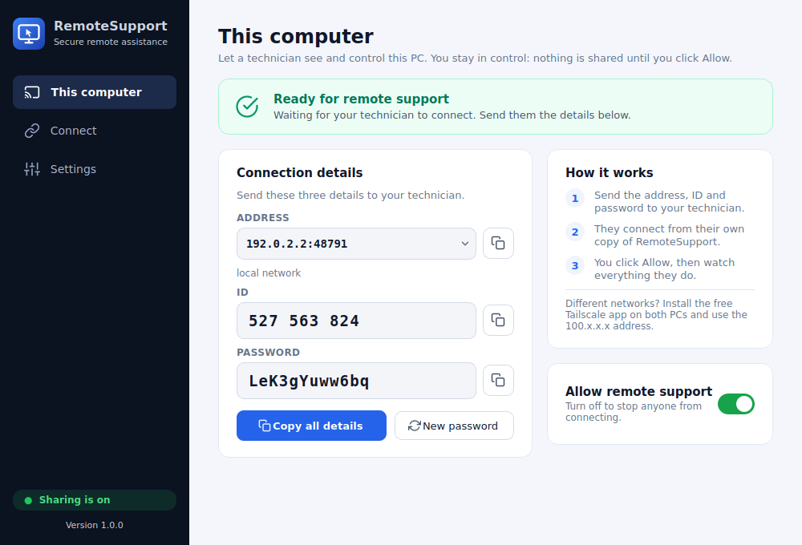
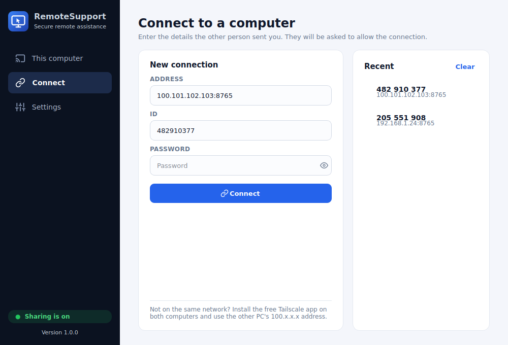
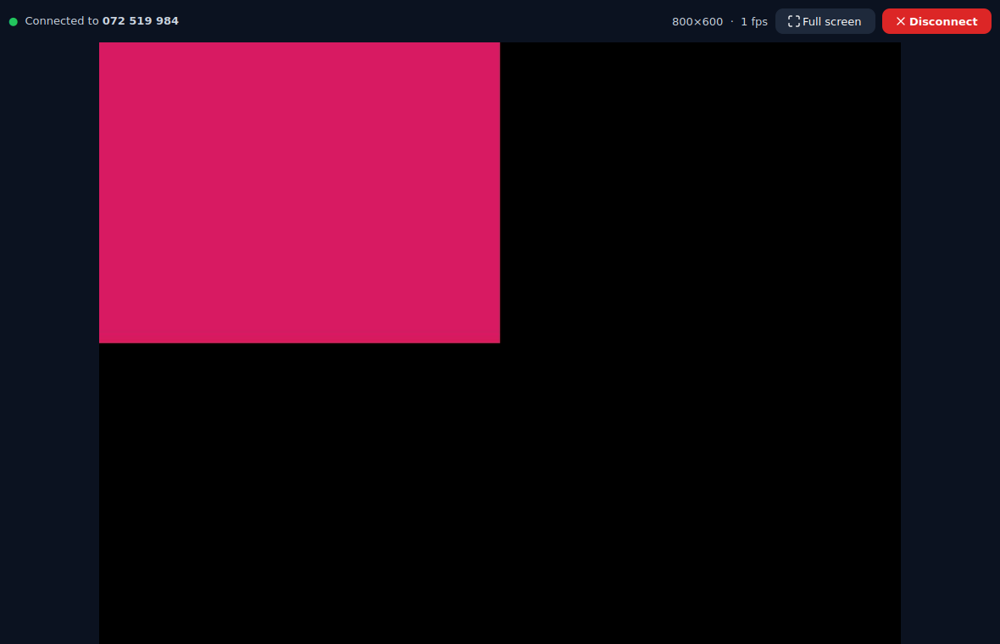

# RemoteSupport

A professional, self-hosted remote-support app for Windows, macOS and Linux (PySide6 / Python).
**One app for everyone**: the person who needs help just opens it; the technician opens the same app and
picks *Connect*. Direct PC-to-PC, end-to-end encrypted, **no server to host**.

<p align="center"></p>

## How it works
| Role | What you do |
|---|---|
| **Client** (needs help) | Open RemoteSupport. That's it: *This computer* is shown, sharing is on, and you read your **Address, ID and Password** to the technician (or press *Copy all details* and paste them in WhatsApp/email). When they connect you click **Allow**. A red banner + **Disconnect** button stay on screen for the whole session. |
| **Technician** (you) | Open RemoteSupport, click **Connect** in the sidebar, enter Address + ID + Password, press Connect. You get a live, fully controllable view of the other screen (mouse, keyboard, scroll, full-screen). Recent connections are remembered (never passwords). |

<p align="center">
 
</p>

## Run it
```bash
pip install -r requirements.txt        # Python 3.10+   (Linux also needs: libegl1 libxkbcommon-x11-0 libxcb-cursor0)
python main.py                         # <- the launcher. Same command on both computers.
```
Try both roles on one computer first: open the app, then in *Connect* use address `127.0.0.1:8765`
with the ID and password shown on *This computer* (a second copy of the app is not needed).

### Ready-made installers (no Python needed by clients)
Build the single-file app for the OS you are on:
```bash
python scripts/build.py      # -> dist/RemoteSupport.exe (Windows) | dist/RemoteSupport (Linux) | dist/RemoteSupport.app (macOS)
```
The script installs what is missing, builds, and **smoke-tests the built app** before finishing.
PyInstaller cannot cross-compile, so to get all three platforms at once push this folder to GitHub:
`.github/workflows/build.yml` runs the tests and builds **Windows, macOS and Linux** apps and uploads them as downloads.
Give the same file to every client and use it yourself.

## Android app (technician)
A native Android app lives in [`android/`](android/README.md). It connects to this desktop app (same protocol,
same encryption) so you can see and control a client's PC from your phone. Push the repo to GitHub and the
**Build Android APK** workflow (`.github/workflows/android.yml`) produces `RemoteSupport.apk` as a downloadable artifact.

## Using it across the internet (no server of yours)
A direct connection needs the client's PC to be reachable. Home routers block incoming connections, so choose one:
1. **Tailscale (recommended, free for personal use).** Install it on both PCs and sign in. Each PC gets a private
   `100.x.x.x` address that works through any router/NAT with zero configuration. RemoteSupport shows it first in the
   *Address* list. (ZeroTier works the same way.)
2. **Port forwarding.** Forward TCP port `8765` (changeable in Settings) on the client's router to their PC and use
   their public IP. Often impossible (mobile data/CGNAT) and exposes the port; prefer option 1.
3. **Same network / VPN / hotspot.** Works immediately with the LAN address shown in the app.

Windows asks to allow network access the first time sharing starts: click *Allow*.

## Security
- **Password-gated:** challenge-response (PBKDF2-SHA256, 300k iterations + HMAC). The password never crosses the network,
  and the client proves it knows it too, so a fake host cannot impersonate the real one.
- **End-to-end encrypted** (AES-256-GCM, per-direction keys, replay/tamper detection) even over plain `ws://`.
- **Client stays in control:** nothing is visible until the client clicks *Allow*; always-on-top red banner and a
  *Disconnect* button during the session; held keys/buttons are released on disconnect; no hidden or startup mode.
- **Brute-force protection:** 5 wrong passwords lock the client for 60 s; one technician at a time.
- Random 12-character passwords by default (~70 bits). Press *New password* for a fresh one per session.

## Settings
Start sharing on launch, port, screen quality (Fast / Balanced / Sharp), keep running in the system tray.

## Limitations (v1.0)
- Clients are computers. The Android app is a *technician* (viewer/controller) for them; controlling a phone itself is not supported (Android needs a native accessibility service; iOS forbids it).
- Windows UAC prompts, the lock screen and Ctrl+Alt+Del live on a secure desktop a normal app can't see
  (running as a service is the next step). Linux needs an X11 session (Wayland blocks capture/injection).
  macOS: grant *Screen Recording* and *Accessibility* to RemoteSupport in System Settings.
- Not included yet: clipboard sync, file transfer, audio, multi-monitor picker.
- Screen is sent as changed-region JPEG: great for desktop work, not for watching video.

## Tests
```bash
pip install -r requirements-dev.txt
python -m pytest                     # 27 tests: UI (two real windows talking), crypto, auth, lockout, consent, TLS, relay
python tests/live_qt_test.py         # real screen capture + real mouse/keyboard through the Qt app (Linux + Xvfb)
python tests/live_xvfb_test.py       # same with the headless CLI agent
```

## Troubleshooting
| Symptom | Fix |
|---|---|
| "Could not reach that address" | Wrong IP/port, sharing is off on the other PC, firewall blocks the port, or you are not on the same network/Tailscale. |
| "Cannot use port 8765" | Another program uses it. Pick a different port in *Settings*. |
| "Wrong ID or password" | Check for typos (passwords are case-sensitive). After *New password* the old one stops working. |
| "Locked after failed attempts" | Wait one minute. |
| Black remote screen on Linux | The client is on Wayland; log in with an X11 session. |

Logs: `%APPDATA%\RemoteSupport\remotesupport.log` (Windows), `~/Library/Application Support/RemoteSupport/` (macOS),
`~/.local/share/RemoteSupport/` (Linux).

## Project layout
```
main.py                     launcher (python main.py)
rsupport/ui/                PySide6 app: main_window.py, remote.py, widgets.py, theme.py, controllers.py, app.py
rsupport/host.py            client-side engine (capture, auth, input injection)   viewer.py  technician-side engine
rsupport/crypto.py          handshake + AES-GCM          capture.py / inputctl.py  screen + input   relay.py  optional relay
scripts/build.py            one-command packaging        .github/workflows/build.yml  CI for Win/macOS/Linux
android/                    Android app (Kotlin)         .github/workflows/android.yml  CI that builds the APK
tests/                      pytest suite + live tests    deploy/  optional relay (Docker + Caddy) if you ever want one
```
CLI extras: `python -m rsupport host` (headless agent), `snapshot`, `relay`, `selftest`.

**Use only on computers whose owner has agreed to the session.**
